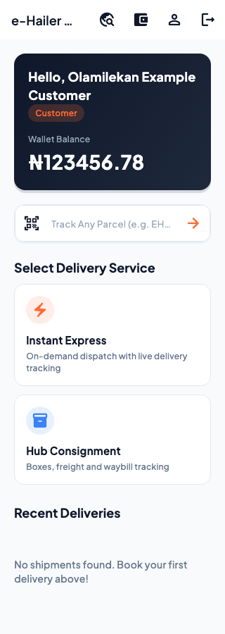
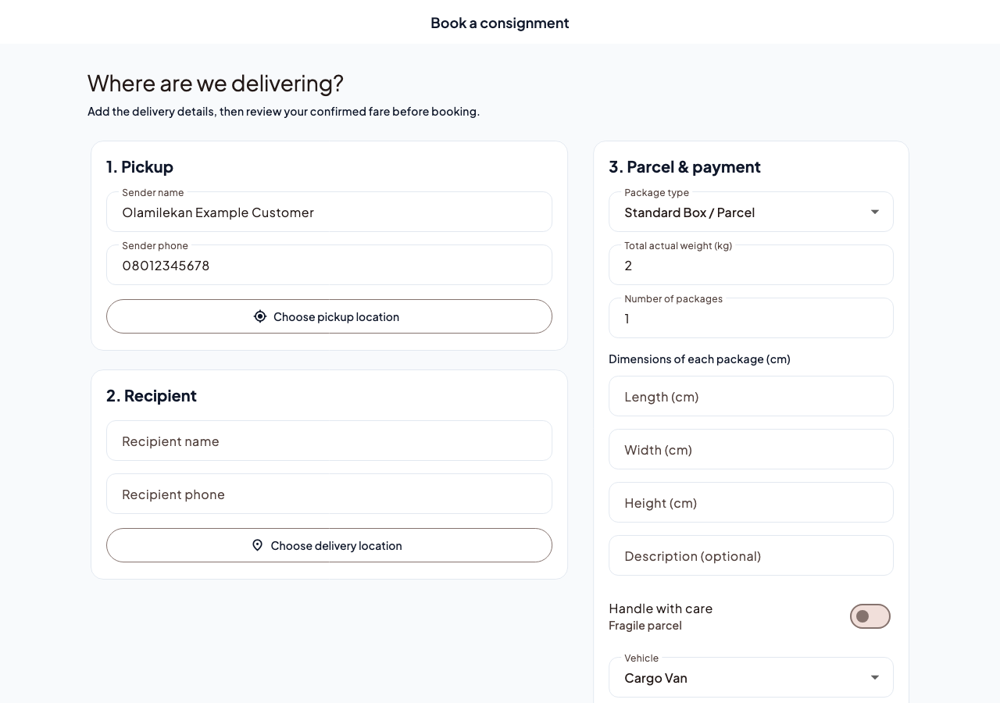

# e-Hailer

**A Flutter courier and logistics application for customers, drivers and operations teams.** Customers book express deliveries or consignments, drivers manage assigned work, and staff coordinate dispatch, disputes and payouts.

The app combines Firebase Authentication and realtime Firestore reads with a **Serverpod Dart API** that controls delivery and financial mutations. It uses OpenStreetMap and OSRM for mapping and road routes, manual Equatable models, Riverpod state management and a feature-based domain/infrastructure/presentation structure.

> **Current status:** implemented and tested locally; not deployed or certified for production. Paystack hosted wallet funding now has server verification and signed webhooks, tested with a local provider stub. A real Paystack test-mode checkout, production reconciliation, automated bank transfers, background location and dispatch-triggered push delivery remain release work. Existing balances and deliveries require a reviewed migration before rollout.

## What the app does

| Role | Main capabilities |
| --- | --- |
| Customer | Register/sign in, choose pickup and destination, enter parcel/contact details, review a server-calculated fare, book with an existing wallet balance or cash on delivery, track deliveries, access the private handover PIN, rate completed work and raise disputes. |
| Driver | Manage availability and vehicle details, accept compatible available jobs, follow permitted delivery milestones, share location while the active screen is open, verify handover, view earnings and request a payout. |
| Administrator | Review the dispatch queue, assign or reassign compatible drivers, inspect fleet and operating metrics, resolve disputes, authorize bounded refunds and record completed manual payout transfers. |
| Support | Review and claim disputes, record resolutions within assigned authority; financial refunds require an administrator. |
| Public visitor | Look up a shared tracking token to see a redacted status and milestone history without signing in. |

Staff accounts are provisioned through a trusted administrative process. Self-registration creates only customer or driver accounts; there is no client role switcher.

## Booking and delivery

1. Choose **Instant Express** or **Hub Consignment**.
2. Enter sender/recipient details, select map pins and add street directions. Optional address search requires a configured geocoding service.
3. Describe the parcel: total physical weight, package count, per-package dimensions, category and handling requirements. Choose a suitable vehicle and supported payment method.
4. Review the road distance, estimated duration and fare returned by the API. A quote is bound to the customer and inputs and expires after ten minutes.
5. Confirm the booking. A quote can create one order; retry receipts prevent repeated financial effects.
6. Follow dispatch and delivery updates. The assigned driver verifies the private handover PIN before completion and settlement.

Express jobs enter the available-job flow; consignments begin in the operations workflow. Server policy enforces ownership and permitted transitions. Completed or cancelled deliveries cannot be reopened through a status update.

### Pricing and money

The tariff considers vehicle category, road distance and billable weight. Billable weight is the greater of total actual weight and volumetric weight: `length × width × height × quantity / 5000`, using centimetres and kilograms. The divisor and fare rates are application policy, not a universal carrier tariff.

Wallet charges, driver earnings, cash commissions, payout reservations and refunds are calculated and recorded by the trusted API in Firestore transactions using integer minor-unit arithmetic. Wallet bookings require an existing balance. Cash completion records collection and commission; it does not fabricate a digital payment. Payout approval records an administrator-confirmed bank transfer and does not send money to a bank.

Customers and drivers can fund a wallet through **Paystack hosted checkout** when the backend is configured. The API creates a private payment intent; the app opens Paystack in a browser. Only a matching server-verified successful transaction credits the wallet. Signed webhooks and manual verification share duplicate protection, and pending checkout can be recovered after restarting the app. Test payments require an isolated Firebase environment. See the [payment setup and acceptance guide](docs/PAYMENTS.md).

### Privacy and reliability

- Firebase ID tokens establish the caller; payload roles, user IDs and prices cannot grant authority.
- Firestore Rules deny direct client writes to deliveries, ledger entries, payouts and disputes.
- Handover PINs live in a separate private collection. Drivers submit a PIN for verification; they cannot read it. Failed attempts have a persistent lockout.
- Public tracking exposes an expiring, unguessable token and an allowlist of progress fields, excluding contacts, precise coordinates, financial data and PINs.
- Ambiguous API retries retain their request key during the current app session. App-restart recovery and production reconciliation remain operational concerns.

## Interface and layouts

Forms and dashboards use bounded content widths. Booking and tracking panels sit alongside each other on wider windows and stack on small screens or at large text sizes. Text follows the operating system's accessibility scale; the bundled Plus Jakarta Sans font works without a runtime font download. Map attribution and open-source licenses are accessible in the app.

The images below are **rendered widget fixtures with synthetic data**, not evidence of live deliveries or physical-device acceptance.

| Customer on a narrow phone | Booking on a wide window |
| --- | --- |
|  |  |

## Architecture

```text
Flutter presentation + Riverpod
  ├─ Firebase Authentication → ID token
  ├─ Serverpod command API → authorization + policies → Firestore transactions
  └─ Firestore Rules → authorized realtime reads / redacted tracking
```

The API owns quotes, assignments, lifecycle changes, PIN checks and financial commands. Firestore remains the datastore; this implementation requires neither PostgreSQL nor Redis. The generated Serverpod client is transport infrastructure. Flutter domain entities remain handwritten, with no build_runner, Freezed or Riverpod generator.

Explore the Archify [delivery architecture](docs/architecture.html) and [payment architecture](docs/payments-architecture.html), read the [architecture explanation](docs/ARCHITECTURE.md), or browse the [Graphify structural code map](docs/codebase-map.html). Open the HTML files locally; GitHub's source view does not run these viewers. The Archify diagrams pin local source snapshots of the implementation and do not claim a production deployment.

## Project structure

```text
lib/
  core/                         shared domain, infrastructure, styles and routing
  features/
    auth/ delivery/ map/
    wallet/ admin/ notification/
      domain/                   entities, value objects and policies
      infrastructure/           Firebase read services and trusted API adapters
      presentation/             providers, screens, routes and widgets
server/
  ehailer_server/                domain commands, Firestore adapter, endpoint, tests
  ehailer_client/                generated API transport client
assets/                         fonts, icons and images
test/                          Flutter domain, adapter and UI tests
tool/                          emulator tests, generators and code-map refresh
docs/                          app guide, contracts, diagrams and validation
```

The existing `AGENTS.md` is preserved. The user-authorized Serverpod transport-generation exception is documented in the architecture guide; it does not introduce generation into Flutter domain models.

## Get started locally

Use Flutter **3.47.x stable** with Dart **3.13.x**, Java **21+**, a supported Node runtime, and the Firebase CLI. iOS uses Swift Package Manager. Exact package/tool versions and constrained transitive dependencies are documented in [DEPENDENCIES.md](docs/DEPENDENCIES.md).

From the repository root:

```sh
flutter pub get
(cd server/ehailer_client && dart pub get)
(cd server/ehailer_server && dart pub get)
npm --prefix tool/firestore_tests ci --ignore-scripts
```

Start Firebase emulators in one terminal:

```sh
firebase emulators:start --project demo-ehailer --only auth,firestore
```

Start the API in another:

```sh
test -f server/ehailer_server/.env || cp server/ehailer_server/.env.example server/ehailer_server/.env
python3 tool/server_env.py
```

Launch the app:

```sh
test -f .env.demo || cp .env.example .env.demo
python3 tool/flutter_env.py --env .env.demo run -d chrome
```

For an Android emulator use `10.0.2.2` in both client host values. Physical-device testing requires a reachable HTTPS API. Emulator mode is debug-only; no real payment or production data is required for the automated suite. See the [development guide](docs/DEVELOPER_GUIDE.md) for account setup, CLI generation and platform notes.

### Configuration

Keep values in ignored local environment files and use the validated build/launch wrappers in [ENVIRONMENT.md](docs/ENVIRONMENT.md). Client defines are extractable from compiled apps: they may contain public Firebase identifiers, never Paystack secrets, admin credentials or signing passwords. Native Firebase files and web worker configuration are generated locally from the same allowlisted client settings.

| Setting | Purpose |
| --- | --- |
| `FIREBASE_PROJECT_ID` | Backend Firebase project. Use `demo-ehailer` for isolated emulator work. |
| `FIREBASE_*_API_KEY`, `FIREBASE_*_APP_ID` | Public client identifiers supplied from the client env; no hardcoded project fallback. |
| `PAYSTACK_SECRET_KEY`, `PAYSTACK_MODE` | Server-only payment credentials and matching `test`/`live` mode; no secret disables checkout. |
| `PAYSTACK_TEST_PROJECT_ID` | Explicitly isolated staging project for test payments outside emulators. |
| `E_HAILER_API_URL` | Flutter API endpoint; HTTPS outside explicitly allowed debug loopback hosts. |
| `OSRM_BASE_URL` | Backend authoritative route service; Flutter's define controls route previews. |
| `NOMINATIM_BASE_URL` | Optional configured address-search service. Pin selection works without it. |
| `E_HAILER_PUBLIC_URL` | Confirmed public tracking host; without it sharing copies the tracking code. |

Production uses Application Default Credentials on the server. Never put service-account or payment secrets in Flutter assets or defines. The [deployment guide](docs/DEPLOYMENT.md) documents the native server bundle, HTTPS ingress, webhook listener and environment template. Configure routing capacity, rate limits, retention, hosting/deep links and monitoring before release. The [database guide](docs/DATABASE_SCHEMA.md) describes legacy-data migration and reconciliation prerequisites.

## Tests and verification

```sh
flutter analyze --no-pub
flutter test --no-pub
(cd server/ehailer_server && dart analyze && dart test)
bash tool/test_emulators.sh
npm --prefix tool/firestore_tests audit
```

Run Flutter commands sequentially. The emulator runner exercises Firestore authorization, transaction races, authenticated Serverpod calls and signed webhooks using local routing/payment stubs. Layout tests cover phone, tablet and desktop widths with increased text sizes. The [validation record](docs/VALIDATION.md) lists completed checks, build results and their limits; it distinguishes local tests from deployment and device acceptance.

## Documentation and contribution

The [documentation index](docs/README.md) is the main entry point. Start with the [app guide](docs/APP_GUIDE.md) for role-based workflows, [feature status](docs/FEATURES_SPECIFICATION.md) for implemented versus remaining work, and [reference review](docs/REFERENCE_REVIEW.md) for design lessons from the upstream repositories.

For changes, preserve the feature layers, manual domain models, functional error handling, and centralized routes/assets. Add regression coverage at the affected boundary, update API/schema docs when contracts change, and refresh Archify/Graphify when their source changes. Pull requests should explain the behavior change, validation performed and any migration or configuration impact. Keep generated files synchronized with the pinned Serverpod CLI.

The [security audit](docs/SECURITY_AUDIT.md) records fixes, scanned dependencies/history and remaining release risks. Enable the staged-file guard with `git config --local core.hooksPath .githooks`; CI also scans public files and Git history. Read [SECURITY.md](SECURITY.md) before sharing findings or handling credentials.

## License

Original project code is available under the [MIT License](LICENSE), copyright 2026 Lekki369 and e-Hailer contributors. See [third-party notices](THIRD_PARTY_NOTICES.md) for fonts, tooling, dependencies and map attribution.
