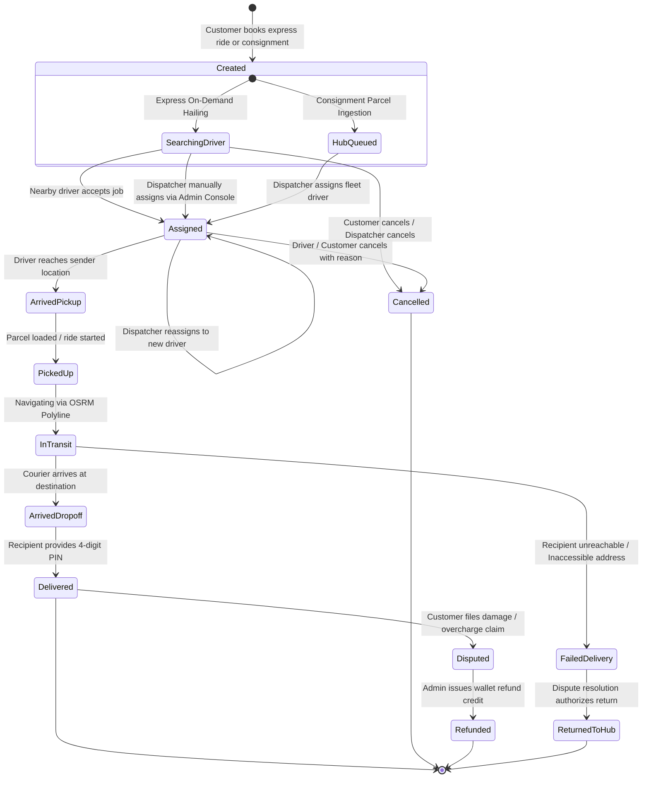

# e-Hailer Platform Architecture & Operational Template Guide

A production-ready Flutter and Firebase architecture template combining **On-Demand Express Dispatch**, **Hub-and-Spoke Consignment Logistics**, and **Centralized Fleet Operations Command**.

Built with:
- **Architecture**: Domain-Driven Design (DDD) & Clean Layered Architecture
- **State Management**: Pure `hooks_riverpod` (Compile-safe, reactive streams, **Zero `build_runner`**)
- **Data Models**: Pure Dart 3 Immutable Entities with `package:equatable`
- **Routing**: `go_router` with declarative role-based auth redirection (`Customer`, `Driver`, `Admin`)
- **Functional Programming**: `fpdart` (`Either<AppFailure, T>`, `Unit`)
- **Mapping & Navigation**: OpenStreetMap via `flutter_map` + OSRM (100% free, **Zero Google Maps Billing**)
- **Backend**: Cloud Firestore + Firebase Authentication (**Zero Cloud Storage / Zero Paid GCS dependencies**)

---

## 1. Reference Blueprint Synthesis: Fleetbase, ERPNext & osTicket

`e-Hailer` synthesizes the architectural best practices of three open-source enterprise standards to complete the operational logistics layer:

| Reference Platform | Specialization Adopted | Implementation in e-Hailer |
| :--- | :--- | :--- |
| **Fleetbase** | Dispatch command center, real-time order board, driver assignment/reassignment, live fleet map, route telemetry, and unauthenticated public tracking portal. | [`AdminDashboardScreen`](file:///Users/olamilekanawomewe/Desktop/FLUTTER%20PROJECTS/e_hailer/lib/features/admin/presentation/screens/admin_dashboard_screen.dart)<br>[`DispatchQueueScreen`](file:///Users/olamilekanawomewe/Desktop/FLUTTER%20PROJECTS/e_hailer/lib/features/admin/presentation/screens/dispatch_queue_screen.dart)<br>[`ManualAssignmentModal`](file:///Users/olamilekanawomewe/Desktop/FLUTTER%20PROJECTS/e_hailer/lib/features/admin/presentation/widgets/manual_assignment_modal.dart)<br>[`DriverManagementScreen`](file:///Users/olamilekanawomewe/Desktop/FLUTTER%20PROJECTS/e_hailer/lib/features/admin/presentation/screens/driver_management_screen.dart)<br>[`AdminMapOverviewScreen`](file:///Users/olamilekanawomewe/Desktop/FLUTTER%20PROJECTS/e_hailer/lib/features/admin/presentation/screens/admin_map_overview_screen.dart)<br>[`PublicTrackingScreen`](file:///Users/olamilekanawomewe/Desktop/FLUTTER%20PROJECTS/e_hailer/lib/features/delivery/presentation/screens/public_tracking_screen.dart) |
| **ERPNext** | Financial ledger, double-entry digital wallet transactions, 80/20 driver/platform commission model, driver withdrawal payout queue, administrative settlement/refund actions, and multi-horizon business analytics. | [`WalletScreen`](file:///Users/olamilekanawomewe/Desktop/FLUTTER%20PROJECTS/e_hailer/lib/features/wallet/presentation/screens/wallet_screen.dart)<br>[`PayoutManagementScreen`](file:///Users/olamilekanawomewe/Desktop/FLUTTER%20PROJECTS/e_hailer/lib/features/wallet/presentation/screens/payout_management_screen.dart)<br>[`FareBreakdownBottomSheet`](file:///Users/olamilekanawomewe/Desktop/FLUTTER%20PROJECTS/e_hailer/lib/features/wallet/presentation/widgets/fare_breakdown_bottom_sheet.dart)<br>[`PayoutRequestModal`](file:///Users/olamilekanawomewe/Desktop/FLUTTER%20PROJECTS/e_hailer/lib/features/wallet/presentation/widgets/payout_request_modal.dart)<br>[`AnalyticsDashboardScreen`](file:///Users/olamilekanawomewe/Desktop/FLUTTER%20PROJECTS/e_hailer/lib/features/admin/presentation/screens/analytics_dashboard_screen.dart) |
| **osTicket** | Delivery exception handling, ticket categorization, customer damage claims, operator arbitration, customer wallet refund credits, and return-to-hub authorizations. | [`delivery_dispute.dart`](file:///Users/olamilekanawomewe/Desktop/FLUTTER%20PROJECTS/e_hailer/lib/features/delivery/domain/entities/delivery_dispute.dart)<br>[`DisputeManagementScreen`](file:///Users/olamilekanawomewe/Desktop/FLUTTER%20PROJECTS/e_hailer/lib/features/delivery/presentation/screens/dispute_management_screen.dart)<br>[`ReportDeliveryIssueModal`](file:///Users/olamilekanawomewe/Desktop/FLUTTER%20PROJECTS/e_hailer/lib/features/delivery/presentation/widgets/report_delivery_issue_modal.dart)<br>[`FileDisputeModal`](file:///Users/olamilekanawomewe/Desktop/FLUTTER%20PROJECTS/e_hailer/lib/features/delivery/presentation/widgets/file_dispute_modal.dart) |

---

## 2. System Topology & Architecture Graph

```mermaid
flowchart TD
    subgraph UI["Presentation Layer (Flutter Hooks + Riverpod)"]
        direction TB
        CustomerScreens["Customer Views (Booking & Tracking)\n• CustomerHomeScreen\n• ExpressBookingScreen\n• ConsignmentCreationScreen\n• OrderTrackingScreen\n• PublicTrackingScreen"]
        DriverScreens["Driver Views (Terminal & Handover)\n• DriverDashboardScreen\n• ActiveDeliveryScreen\n• ReportDeliveryIssueModal"]
        AdminScreens["Admin Dispatch Views (Fleetbase Command)\n• AdminDashboardScreen\n• DispatchQueueScreen\n• DriverManagementScreen\n• AdminMapOverviewScreen\n• ManualAssignmentModal\n• AnalyticsDashboardScreen"]
        WalletScreens["Wallet & Dispute Views (ERPNext & osTicket)\n• WalletScreen\n• PayoutManagementScreen\n• PayoutRequestModal\n• DisputeManagementScreen\n• FileDisputeModal"]
        
        RiverpodProviders["Riverpod Providers\n• authStateProvider & currentUserProfileProvider\n• activeOrderStreamProvider & availableOrdersStreamProvider\n• allOrdersStreamProvider & fleetDriversStreamProvider\n• operationsAnalyticsProvider & disputesStreamProvider"]
    end

    subgraph Domain["Domain Layer (Pure Dart 3 + Equatable)"]
        direction TB
        Entities["Entities\n• DeliveryOrder & DeliveryDispute\n• UserEntity & PayoutRequest\n• FleetDriverSummary & OperationsAnalytics\n• LocationPoint, ParcelDetails, PricingDetails, RouteResult"]
        ValueObjects["Value Objects & Enums\n• UserRole, DeliveryStatus, DeliveryType, VehicleType\n• DisputeCategory, DisputeStatus, PayoutStatus, TransactionType"]
        DomainServices["Domain Services\n• PricingCalculator (Volumetric & Road Distance)"]
        Failures["Failures (Sealed Classes)\n• AppFailure (Server, Auth, Network, Location, InvalidOtp)"]
    end

    subgraph Infrastructure["Infrastructure Layer (External Adapters)"]
        direction TB
        AuthService["AuthRemoteService\n(Firebase Auth + Firestore /users)"]
        DeliveryService["DeliveryRemoteService\n(Firestore /deliveries & Handover PIN)"]
        AdminService["AdminRemoteService\n(Dispatch streams & manual assignment)"]
        WalletService["WalletRemoteService\n(Atomic ledger, payouts & top-up)"]
        DisputeService["DisputeRemoteService\n(Arbitration, wallet refund & returns)"]
        OsmService["OsmRoutingService\n(OSRM polylines & Nominatim geocoding)"]
    end

    subgraph CloudServices["External Cloud & Open APIs"]
        direction TB
        FirebaseAuth["Firebase Authentication (Phone OTP & Email)"]
        Firestore["Cloud Firestore Database"]
        OSRM["Open Source Routing Machine (OSRM API)"]
        OSM["OpenStreetMap Free Raster Tile Servers"]
    end

    UI --> RiverpodProviders
    RiverpodProviders --> Infrastructure
    Infrastructure --> Domain
    UI --> Domain
    
    AuthService --> FirebaseAuth
    AuthService --> Firestore
    DeliveryService --> Firestore
    AdminService --> Firestore
    WalletService --> Firestore
    DisputeService --> Firestore
    OsmService --> OSRM
    CustomerScreens --> OSM
    DriverScreens --> OSM
    AdminScreens --> OSM
```



---

## 3. Order Lifecycle State Machine



---

## 4. Operational Modules & Phased Implementation

### Phase 1: Admin Dispatch Workflow (Reference: Fleetbase)
- **Goal**: Turn the administration console into an industrial dispatch center.
- **Components**:
  1. [`AdminDashboardScreen`](file:///Users/olamilekanawomewe/Desktop/FLUTTER%20PROJECTS/e_hailer/lib/features/admin/presentation/screens/admin_dashboard_screen.dart):
     - Real-time KPI summaries: Total Active Orders, Assigned Orders, Unassigned Orders, Delayed Orders, Online Drivers, Today's Gross Revenue.
     - Quick navigation to Queue, Fleet Map, Drivers, Payouts, and Analytics.
  2. [`DispatchQueueScreen`](file:///Users/olamilekanawomewe/Desktop/FLUTTER%20PROJECTS/e_hailer/lib/features/admin/presentation/screens/dispatch_queue_screen.dart):
     - Filterable by operational state: `All`, `Pending`, `Assigned`, `In Transit`, `Delivered`, `Cancelled`.
     - Real-time search across Waybill numbers, customer names, phone numbers, and addresses.
  3. [`DriverManagementScreen`](file:///Users/olamilekanawomewe/Desktop/FLUTTER%20PROJECTS/e_hailer/lib/features/admin/presentation/screens/driver_management_screen.dart):
     - Driver roster displaying online/offline status, vehicle category, plate number, trip volume, and customer rating.
  4. [`ManualAssignmentModal`](file:///Users/olamilekanawomewe/Desktop/FLUTTER%20PROJECTS/e_hailer/lib/features/admin/presentation/widgets/manual_assignment_modal.dart):
     - Single-tap driver assignment filtered by online availability (`isAvailable == true`) and vehicle class.
     - Atomic Firestore batch transaction updating order status and driver profile.
  5. [`AdminMapOverviewScreen`](file:///Users/olamilekanawomewe/Desktop/FLUTTER%20PROJECTS/e_hailer/lib/features/admin/presentation/screens/admin_map_overview_screen.dart):
     - OpenStreetMap live visualization rendering green markers for online drivers and orange markers for pending pickups with direct assignment sheet.

---

### Phase 2: Payout and Earnings System (Reference: ERPNext + Fleetbase)
- **Goal**: Implement double-entry wallet accounting, automated commission splits, and bank withdrawal workflows.
- **Business Rules**:
  - **Platform Commission**: 20%
  - **Driver Net Earnings**: 80%
  - **Digital Payment Settlement**: Driver wallet atomically credited with +80% net earnings upon PIN verification.
  - **Cash on Delivery (COD) Settlement**: Driver collects 100% physical cash; driver wallet atomically debited by -20% platform commission (`TransactionType.codCommission`).
- **Components**:
  1. [`WalletScreen`](file:///Users/olamilekanawomewe/Desktop/FLUTTER%20PROJECTS/e_hailer/lib/features/wallet/presentation/screens/wallet_screen.dart): Live balance, transaction history ledger, top-up modal.
  2. [`PayoutManagementScreen`](file:///Users/olamilekanawomewe/Desktop/FLUTTER%20PROJECTS/e_hailer/lib/features/wallet/presentation/screens/payout_management_screen.dart): Driver withdrawal request queue (`pending`, `settled`, `rejected`), approve with bank reference, or reject with atomic refund.
  3. [`FareBreakdownBottomSheet`](file:///Users/olamilekanawomewe/Desktop/FLUTTER%20PROJECTS/e_hailer/lib/features/wallet/presentation/widgets/fare_breakdown_bottom_sheet.dart): Displays Base Fare, Road Distance, Volumetric Excess, Fragile Surcharge, and 80/20 Driver/Platform split.
  4. [`PayoutRequestModal`](file:///Users/olamilekanawomewe/Desktop/FLUTTER%20PROJECTS/e_hailer/lib/features/wallet/presentation/widgets/payout_request_modal.dart): NUBAN 10-digit account validation, Nigerian bank selection, immediate balance locking.

---

### Phase 3: Public Tracking Experience (Reference: Fleetbase Customer Portal)
- **Goal**: Enable recipients and customers to track consignments without creating an account or logging in.
- **Components**:
  1. [`PublicTrackingScreen`](file:///Users/olamilekanawomewe/Desktop/FLUTTER%20PROJECTS/e_hailer/lib/features/delivery/presentation/screens/public_tracking_screen.dart):
     - Accessible unauthenticated via `/track/:trackingNumber` or `/track`.
     - Live interactive OpenStreetMap rendering pickup, drop-off, and moving courier GPS coordinates.
     - Real-time step-by-step progress timeline.
     - Recipient Handover Security PIN alert banner (fraud prevention).
     - Courier contact card and shareable tracking link clipboard utility.
  2. [`OrderTrackingScreen`](file:///Users/olamilekanawomewe/Desktop/FLUTTER%20PROJECTS/e_hailer/lib/features/delivery/presentation/screens/order_tracking_screen.dart):
     - Authenticated tracking view with on-screen QR Code consignment waybill rendering (`QrImageView`).

---

### Phase 4: Dispute and Issue Handling (Reference: osTicket)
- **Goal**: Handle delivery exceptions, driver delivery failures, damaged parcel claims, and operator arbitration.
- **Status Lifecycle**: `open` $\rightarrow$ `underReview` $\rightarrow$ `resolved` / `dismissed`.
- **Categories**: `damagedItem`, `wrongAddress`, `unreachableRecipient`, `missingItem`, `fareDispute`, `driverMisconduct`.
- **Components**:
  1. [`ReportDeliveryIssueModal`](file:///Users/olamilekanawomewe/Desktop/FLUTTER%20PROJECTS/e_hailer/lib/features/delivery/presentation/widgets/report_delivery_issue_modal.dart): Allows couriers to abort dropoff safely with reason logging (`failedDelivery`).
  2. [`FileDisputeModal`](file:///Users/olamilekanawomewe/Desktop/FLUTTER%20PROJECTS/e_hailer/lib/features/delivery/presentation/widgets/file_dispute_modal.dart): Customer claim submission attached to order with claimant contact and category.
  3. [`DisputeManagementScreen`](file:///Users/olamilekanawomewe/Desktop/FLUTTER%20PROJECTS/e_hailer/lib/features/delivery/presentation/screens/dispute_management_screen.dart): Operations arbitration desk at `/admin/disputes`. Authorizes atomic wallet refunds, initiates return-to-hub shipments, or dismisses claims.

---

### Phase 5: Fleet Analytics & KPI Dashboard (Reference: ERPNext + Fleetbase)
- **Goal**: Translate operations into data-driven decision-making and executive visibility.
- **Components**:
  1. [`AnalyticsDashboardScreen`](file:///Users/olamilekanawomewe/Desktop/FLUTTER%20PROJECTS/e_hailer/lib/features/admin/presentation/screens/analytics_dashboard_screen.dart):
     - Dynamic time-horizon slicing: **Today**, **Past 7 Days**, **Past 30 Days**, **All Time**.
     - Gross Merchandise Volume (GMV) and realized 20% platform commission revenue.
     - Fulfillment funnels (Completion rate, In-Transit volume, Failure rate).
     - Settlement modality distribution (Cash on Delivery vs Digital Wallet).
     - Fleet vehicle allocation distribution (Motorcycle, Sedan, Cargo Van, Heavy Truck).
     - Courier performance leaderboard ranked by completed volume, rating, and gross revenue generated.

---

### Phase 6: Production Hardening & Release Polish
- **Firestore Security Rules**: Authored in [`firestore.rules`](file:///Users/olamilekanawomewe/Desktop/FLUTTER%20PROJECTS/e_hailer/firestore.rules) with default-deny, role-based access control (RBAC), and immutable 4-digit handover verification PINs.
- **Swift Package Manager Migration**: Completely eliminated CocoaPods (`ios/Podfile` removed; all plugins resolved via native Swift Packages in Xcode).
- **Zero Google Maps Billing**: 100% free raster tiles from OpenStreetMap + OSRM driving geometries.
- **Zero Paid Cloud Storage**: Cryptographic PIN handover verification eliminates Cloud Storage costs.
- **Static Analysis Standard**: 0 errors, 0 warnings across all files.

---

## 5. Architectural Diagram (Interactive HTML)
An interactive, standalone visual architecture diagram is maintained with Archify at [`docs/architecture.html`](file:///Users/olamilekanawomewe/Desktop/FLUTTER%20PROJECTS/e_hailer/docs/architecture.html).
To re-render or update:
```bash
node .agents/skills/archify/bin/archify.mjs render architecture docs/architecture.json docs/architecture.html
```
