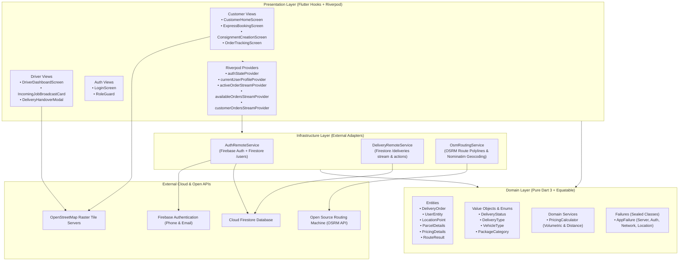
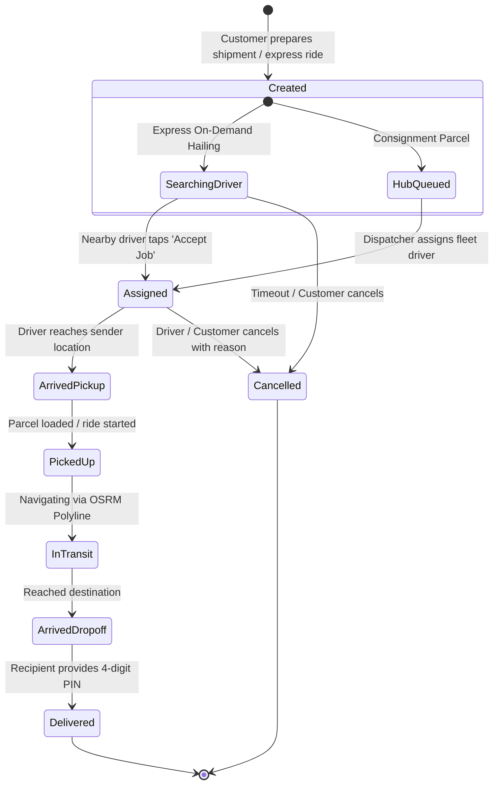

# e-Hailer Platform Architecture & Template Guide

A production-ready Flutter and Firebase architecture template combining **On-Demand Express Dispatch** and **Hub-and-Spoke Consignment Logistics**.

Built with:
- **Architecture**: Domain-Driven Design (DDD) & Clean Layered Architecture
- **State Management**: Pure `hooks_riverpod` (Compile-safe, reactive streams, **Zero `build_runner`**)
- **Data Models**: Pure Dart 3 Immutable Entities with `package:equatable`
- **Routing**: `go_router` with declarative role-based auth redirection
- **Functional Programming**: `fpdart` (`Either<AppFailure, T>`, `Unit`)
- **Mapping & Navigation**: OpenStreetMap via `flutter_map` + OSRM (100% free, **Zero Google Maps Billing**)
- **Backend**: Cloud Firestore + Firebase Authentication (**Zero Cloud Storage / Zero Paid GCS dependencies**)

---

## 1. System Topology & Architecture Graph



---

## 2. Layering Principles & Folder Conventions

Every feature module inside `lib/features/<feature_name>/` follows the strict 3-tier DDD separation:

```
feature_module/
├── domain/                    # PURE DART: Business entities, interfaces, value objects, rules
│   ├── entities/              # Models extending Equatable (props, toMap, fromMap, copyWith)
│   ├── value_objects/         # Enums, validation rules, state enums
│   └── services/              # Pure algorithmic calculations (e.g., PricingCalculator)
│
├── infrastructure/            # IMPLEMENTATION: Remote APIs, SDKs, external dependencies
│   ├── <name>_remote_service.dart  # Firestore / HTTP / Location clients returning Either<AppFailure, T>
│   └── dtos/ (if needed)      # Raw response mappers
│
└── presentation/              # FLUTTER: Widgets, Hooks, and Riverpod State
    ├── providers/             # StreamProviders, StateProviders, Notifiers
    ├── screens/               # Complete pages rendered by GoRouter
    └── widgets/               # Reusable modular UI components
```

### Why No `build_runner`?
Most Flutter templates rely on `freezed`, `json_serializable`, and `riverpod_generator`. While convenient, they introduce:
1. Long build wait times (`dart run build_runner watch` consumes GBs of RAM).
2. Frequent analyzer version mismatch errors during Flutter SDK upgrades.
3. Obfuscated `.freezed.dart` and `.g.dart` generated files that clutter repositories.

In **e-Hailer**, all entities extend [`package:equatable`](https://pub.dev/packages/equatable) with concise `toMap` and `fromMap` factory methods. The resulting codebase is fast, predictable, hot-reloads instantly, and maintains 100% clean static analysis (`flutter analyze` finishes in ~4 seconds).

---

## 3. Order Lifecycle State Machine



---

## 4. Key Engineering Innovations in e-Hailer

### 1. Volumetric Weight vs. Physical Weight
Traditional ride-hailing apps only calculate pricing based on distance. In logistics, bulky lightweight items (e.g., styrofoam, empty boxes) take up cargo space.
Fusing the rule from **courierManagementSystem**:
$$\text{Volumetric Weight (kg)} = \frac{\text{Length (cm)} \times \text{Width (cm)} \times \text{Height (cm)}}{5000}$$
$$\text{Billable Weight} = \max(\text{Physical Weight}, \text{Volumetric Weight})$$

### 2. Free OpenStreetMap + OSRM Road Routing
Zero reliance on Google Maps Platform API keys or billing:
- Tiles: OpenStreetMap standard tiles (`https://tile.openstreetmap.org/{z}/{x}/{y}.png`).
- Driving Routes: Open Source Routing Machine (`router.project-osrm.org`) calculates actual driving road geometries, real kilometers, and traffic travel times.
- Reverse Geocoding: OpenStreetMap Nominatim translates coordinates to street addresses.

### 3. Zero-Cost Handover Verification PIN
Eliminates reliance on paid Cloud Storage (GCS) for signatures or photo uploads:
- Every order auto-generates a secure 4-digit OTP saved in the Firestore order document.
- The recipient provides this code to the courier upon delivery.
- The courier enters the PIN to confirm completion, instantly releasing payment and updating order status.
