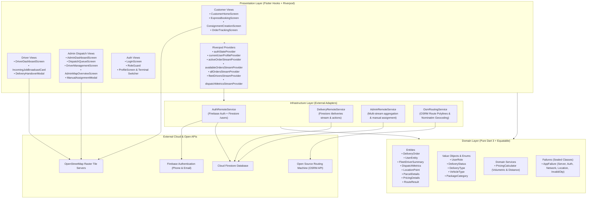
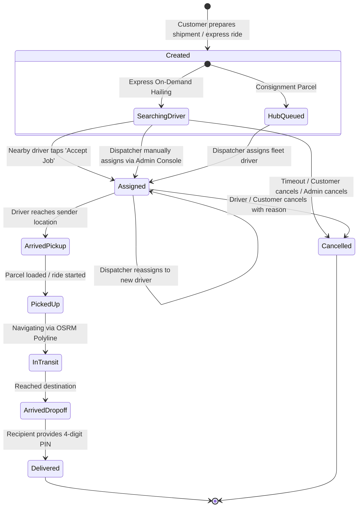
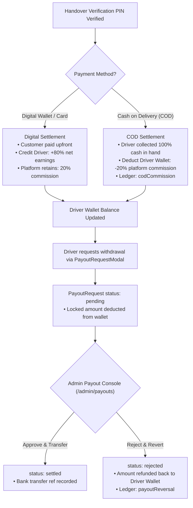
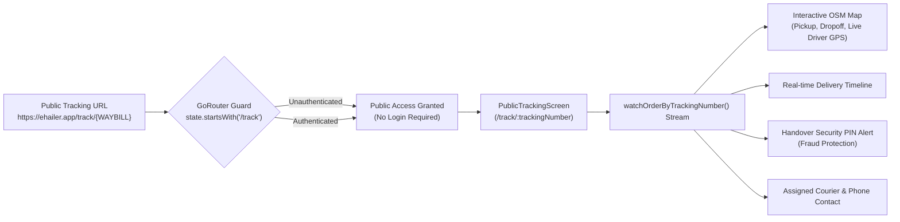
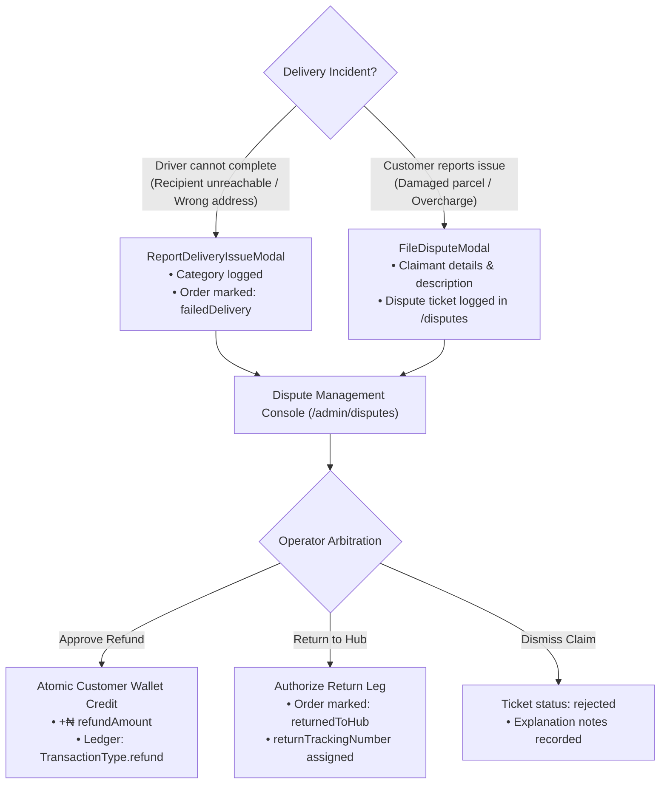
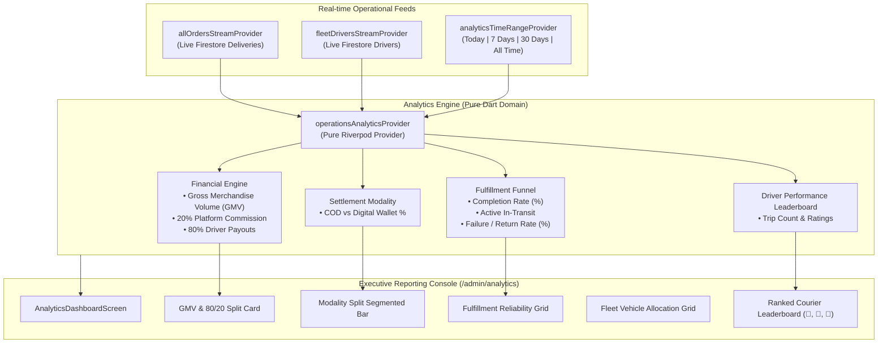

# e-Hailer Platform Architecture & Template Guide

A production-ready Flutter and Firebase architecture template combining **On-Demand Express Dispatch**, **Hub-and-Spoke Consignment Logistics**, and **Centralized Fleet Operations Command**.

Built with:
- **Architecture**: Domain-Driven Design (DDD) & Clean Layered Architecture
- **State Management**: Pure `hooks_riverpod` (Compile-safe, reactive streams, **Zero `build_runner`**)
- **Data Models**: Pure Dart 3 Immutable Entities with `package:equatable`
- **Routing**: `go_router` with declarative role-based auth redirection (`Customer`, `Driver`, `Admin`)
- **Functional Programming**: `fpdart` (`Either<AppFailure, T>`, `Unit`)
- **Mapping & Navigation**: OpenStreetMap via `flutter_map` + OSRM (100% free, **Zero Google Maps Billing**)
- **Backend**: Cloud Firestore + Firebase Authentication (**Zero Cloud Storage / Zero Paid GCS dependencies**)

---

## 1. System Topology & Architecture Graph



---

## 2. Layering Principles & Folder Conventions

Every feature module inside `lib/features/<feature_name>/` follows the strict 3-tier DDD separation:

```
feature_module/
├── domain/                    # PURE DART: Business entities, interfaces, value objects, rules
│   ├── entities/              # Models extending Equatable (props, toMap, fromMap, copyWith)
│   ├── value_objects/         # Enums, validation rules, state enums
│   └── services/              # Pure algorithmic calculations (e.g., PricingCalculator)
│
├── infrastructure/            # IMPLEMENTATION: Remote APIs, SDKs, external dependencies
│   ├── <name>_remote_service.dart  # Firestore / HTTP / Location clients returning Either<AppFailure, T>
│   └── dtos/ (if needed)      # Raw response mappers
│
└── presentation/              # FLUTTER: Widgets, Hooks, and Riverpod State
    ├── providers/             # StreamProviders, StateProviders, Notifiers
    ├── screens/               # Complete pages rendered by GoRouter
    ├── routes/                # Centralized feature route definitions
    └── widgets/               # Reusable modular UI components
```

### Why No `build_runner`?
Most Flutter templates rely on `freezed`, `json_serializable`, and `riverpod_generator`. While convenient, they introduce:
1. Long build wait times (`dart run build_runner watch` consumes GBs of RAM).
2. Frequent analyzer version mismatch errors during Flutter SDK upgrades.
3. Obfuscated `.freezed.dart` and `.g.dart` generated files that clutter repositories.

In **e-Hailer**, all entities extend [`package:equatable`](https://pub.dev/packages/equatable) with concise `toMap` and `fromMap` factory methods. The resulting codebase is fast, predictable, hot-reloads instantly, and maintains 100% clean static analysis (`flutter analyze` finishes in ~4 seconds).

---

## 3. Order Lifecycle State Machine



---

## 4. Key Engineering Innovations in e-Hailer

### 1. Volumetric Weight vs. Physical Weight
Traditional ride-hailing apps only calculate pricing based on distance. In logistics, bulky lightweight items (e.g., styrofoam, empty boxes) take up cargo space.
Fusing the rule from **courierManagementSystem**:
$$\text{Volumetric Weight (kg)} = \frac{\text{Length (cm)} \times \text{Width (cm)} \times \text{Height (cm)}}{5000}$$
$$\text{Billable Weight} = \max(\text{Physical Weight}, \text{Volumetric Weight})$$

### 2. Free OpenStreetMap + OSRM Road Routing
Zero reliance on Google Maps Platform API keys or billing:
- Tiles: OpenStreetMap standard tiles (`https://tile.openstreetmap.org/{z}/{x}/{y}.png`).
- Driving Routes: Open Source Routing Machine (`router.project-osrm.org`) calculates actual driving road geometries, real kilometers, and traffic travel times.
- Reverse Geocoding: OpenStreetMap Nominatim translates coordinates to street addresses.

### 3. Zero-Cost Handover Verification PIN
Eliminates reliance on paid Cloud Storage (GCS) for signatures or photo uploads:
- Every order auto-generates a secure 4-digit OTP saved in the Firestore order document.
- The recipient provides this code to the courier upon delivery.
- The courier enters the PIN to confirm completion, instantly releasing payment and updating order status.

---

## 5. Operations Command Center & Fleet Dispatch Architecture

The `admin` module elevates `e-Hailer` from a mobile app into a complete logistics business operations platform:

### 1. Multi-Role Ecosystem Separation
- **`UserRole.customer`**: Routes to `/home`. Access to on-demand hailing, consignment creation, and order tracking.
- **`UserRole.driver`**: Routes to `/driver`. Access to online/offline broadcast terminal, incoming job requests, and PIN verification.
- **`UserRole.admin`**: Routes to `/admin`. Access to Operations Command Center, Live Dispatch Queue, Fleet Roster, and Real-Time Operations Map.
- **Terminal Switcher**: Built directly into `ProfileScreen` for seamless testing and operational role transitions.

### 2. Live Dispatch Queue (`DispatchQueueScreen`)
- Real-time Firestore stream of all orders across the entire platform.
- Filterable by lifecycle status: `All`, `Pending`, `Assigned`, `In Transit`, `Delivered`, `Cancelled`.
- Instant search filter supporting Waybill tracking numbers, customer names, phone numbers, and addresses.

### 3. Manual Assignment & Reassignment Engine (`ManualAssignmentModal`)
- One-tap assignment sheet that filters registered drivers by online status (`isAvailable == true`) and vehicle class.
- Atomically updates Firestore `deliveries` and links `currentOrderId` to the driver's profile in a batch transaction.
- Supports operational reassignment for delayed or unresponsive drivers with an audit note.

### 4. Fleet Driver Management (`DriverManagementScreen`)
- Full roster overview displaying driver name, phone, vehicle category (Motorcycle, Car, Van, Truck), plate number, and customer rating.
- Live online/offline filter and search bar.

### 5. Fleet Map Overview (`AdminMapOverviewScreen`)
- Free OpenStreetMap interactive view rendering:
  - Green markers for available online drivers with live GPS coordinates.
  - Orange/Primary markers for pending order pickup locations.
  - Interactive tap cards to inspect details and assign orders directly from the map.

---

## 6. Payment, COD Commission Settlement, & Driver Payout Lifecycle

The platform implements a dual payment architecture handling both prepaid digital transactions and physical Cash on Delivery (COD):



### 1. Cash on Delivery (COD) vs Digital Settlement Mechanics
- **Digital Payment (`wallet` / `card`)**:
  - The customer is debited upon booking.
  - Upon delivery PIN verification, the system runs an atomic Firestore transaction crediting the driver's wallet with **80%** of the gross fare (`PricingDetails.driverEarnings`).
  - Ledger entry: `TransactionType.deliveryEarnings`.
- **Cash on Delivery (`cashOnDelivery`)**:
  - The driver collects **100%** of the gross fare in cash directly from the recipient.
  - To collect the platform's cut, the driver's digital wallet balance is atomically debited by **20%** (`PricingDetails.platformCommission`).
  - Ledger entry: `TransactionType.codCommission`.

### 2. Driver Withdrawal & Payout Workflow (`PayoutRequestModal`)
- Fleet drivers access their wallet terminal to submit payout requests to any verified Nigerian commercial bank or Neobank (Access, GTBank, Zenith, Kuda, Moniepoint, etc.).
- Preset chips (`₦2,000`, `₦5,000`, `₦10,000`, `All`) and 10-digit NUBAN validation.
- Submitting locks the requested amount immediately to prevent double-spending.

### 3. Admin Payout Settlement Console (`PayoutManagementScreen`)
- Dedicated command route at `/admin/payouts`.
- Filterable tabs: `All`, `Pending Review`, `Settled`, `Rejected`.
- Real-time search across driver names, phone numbers, and destination account numbers.
- **Approve & Mark Settled**: Records administrator ID, processing timestamp, and bank reference.
- **Reject & Refund**: Prompts for a rejection reason, transitions status to `rejected`, and atomically credits the locked funds back into the driver's digital wallet with a `payoutReversal` transaction.

### 4. Universal Fare Breakdown Modal (`FareBreakdownBottomSheet`)
- Embedded across Customer Tracking, Driver Delivery Terminal, and Admin Dispatch Queue.
- Translucently displays Base Fare, Road Distance, Volumetric Excess, Fragile Surcharge, 80/20 Driver/Platform split, and payment badge.

---

## 7. Customer Public Tracking Portal & Waybill Deep-Linking Architecture

To build trust and transparency, shipments are publicly trackable without mandatory account creation or login barriers:



### 1. Zero-Friction Deep Linking (`/track/:trackingNumber`)
- Customers and recipients can track any shipment by simply following a shared link (`https://ehailer.app/track/WAYBILL-XXXXX`) or navigating to `/track`.
- The router bypasses authentication for all `/track/*` paths while safeguarding administrative and financial screens.

### 2. Live OpenStreetMap Courier Tracking
- Renders free OpenStreetMap vector/raster tiles via `OsmMapWidget`.
- Displays real-time driver coordinates (`driverLatitude`, `driverLongitude`) when the courier is en route, alongside pickup and drop-off markers.

### 3. Fraud-Proof 4-Digit Security PIN Banner
- Explicitly reminds the recipient of their auto-generated 4-digit handover PIN (`recipientSecurityOtp`).
- Instructs the recipient to only provide the code once the package has been physically handed over, preventing premature delivery completions.

### 4. Direct Communication & Barcode Scanner
- Displays the assigned driver's full name, vehicle class, rating, and quick one-tap phone contact dialog.
- Provides an on-screen high-resolution 2D QR Code waybill modal (`QrImageView`) for scanning at hub checkpoints.

---

## 8. Returns, Disputes, & Incident Resolution Architecture

Logistics operations encounter real-world exceptions: damaged parcels, unreachable recipients, inaccessible addresses, or customer claims. `e-Hailer` includes a dedicated arbitration and return-to-hub workflow:



### 1. Driver Delivery Failure Engine (`ReportDeliveryIssueModal`)
- When a courier is unable to complete dropoff, they can report exceptions with specific categories (`unreachableRecipient`, `wrongAddress`, `packageRefused`, `damagedItem`).
- Atomically transitions order status to `DeliveryStatus.failedDelivery` with cancellation reasoning and returns the courier safely to the dashboard.

### 2. Customer Dispute & Damage Claim Portal (`FileDisputeModal`)
- Accessible directly from tracking interfaces (`OrderTrackingScreen` and `PublicTrackingScreen`).
- Captures claimant name, phone number, category (`damagedItem`, `missingItem`, `fareDispute`, `driverMisconduct`), and detailed incident description.

### 3. Operations Arbitration Console (`DisputeManagementScreen` at `/admin/disputes`)
- Real-time Firestore stream with status filters: `All`, `Open Review`, `Refunded`, `Returned to Hub`, `Dismissed`.
- Direct action panel enabling hub operators to:
  1. **Authorize Customer Refund**: Instantly credits customer digital wallet balance with audit transaction log.
  2. **Authorize Return to Hub**: Updates shipment to `returnedToHub` with tracking code.
  3. **Dismiss Claim**: Records findings and closes ticket.

---

## 9. Fleet Analytics & Business Intelligence Engine

Operational sustainability requires real-time visibility into revenue streams, driver output, and shipment fulfillment funnels:



### 1. Dynamic Horizon Slicing
- Operators toggle between **Today**, **Past 7 Days**, **Past 30 Days**, and **All Time** with reactive instantaneous UI updates.
- Orders and driver deliveries are filtered purely in-memory via Riverpod without extra database read queries.

### 2. GMV & 80/20 Platform Revenue Engine
- Automatically aggregates total gross booking values.
- Realizes the **80% Driver Net Payout** and **20% Platform Commission** split, maintaining consistency with `PricingCalculator`.

### 3. Modality Distribution & Cargo Weight
- Tracks customer settlement preferences (**Cash on Delivery** vs **Prepaid In-App Digital Wallet**).
- Computes aggregate physical and volumetric tonnage moved across the courier network in kilograms ($kg$).

### 4. Fleet Vehicle Breakdown & Courier Leaderboard
- Measures dispatch distribution across vehicle tiers (`Motorcycle`, `Sedan`, `Cargo Van`, `Heavy Truck`).
- Ranks top-performing couriers by completed trip volume, customer ratings, and total gross delivery value generated.

